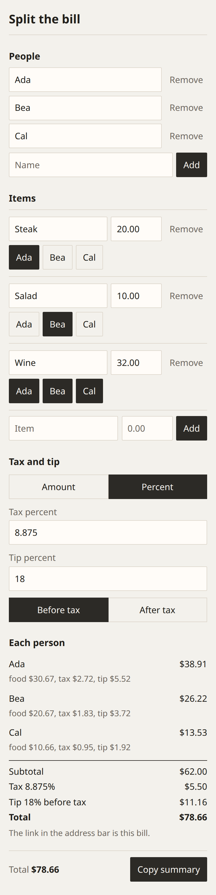

# split-the-bill

Split a restaurant bill by item, with tax and tip, so the cents add up.

**Live:** https://frozenmango8.github.io/split-the-bill/



## Run locally

```sh
npm install
npm test
npm run dev
```

Open the URL Vite prints. It includes `/split-the-bill/`. The address bar is the share link. After one online visit, a reload works offline.
